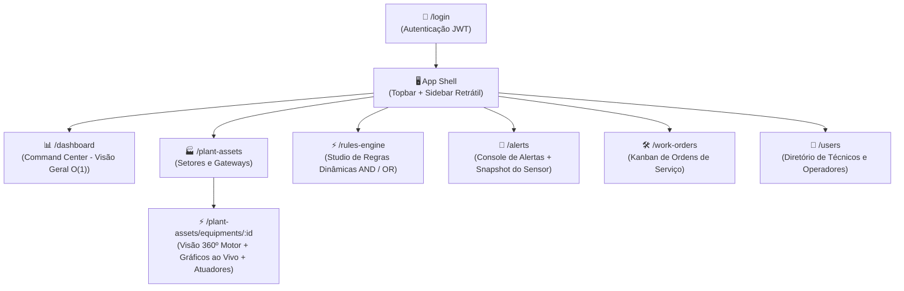

# 🧭 Blueprint Visual & Arquitetura de Telas: Industrial IIoT

Este documento é o seu mapa de navegação para o frontend. Ele detalha **cada tela** que vamos construir, como elas se parecem (wireframes), quais informações exibem e como se conectam diretamente aos endpoints do seu backend Spring Boot.

---

## 🗺️ 1. Mapa Geral de Navegação (Sitemap)

A aplicação segue uma estrutura de **Single Page Application (SPA)** com navegação centralizada no **Shell** (Menu Lateral + Barra Superior).



---

## 🏗️ 2. A Moldura Global: O App Shell

Todas as telas vivem dentro desta estrutura fixa. Apenas a área **Conteúdo Principal** é alterada quando você clica em um item do menu.

```
+-----------------------------------------------------------------------------------------+
| [IIoT Plant Monitor]   | 🟢 CONECTADO (SSE Ativo)   | 🚨 3 Alertas Pendentes | 👤 Igor H. |
+------------------------+----------------------------------------------------------------+
| ☰ MENU                |                                                                |
| 📊 Dashboard           |                                                                |
| 🏭 Ativos da Planta    |                                                                |
| ⚡ Motor de Regras     |                    CONTEÚDO PRINCIPAL                          |
| 🚨 Alertas (3)         |               (<router-outlet></router-outlet>)                |
| 🛠️ Ordens de Serviço  |                                                                |
| 👥 Usuários            |                                                                |
|                        |                                                                |
| ⚙️ Configurações       |                                                                |
+------------------------+----------------------------------------------------------------+
```

---

## 📱 3. Anatomia Visual de Cada Tela

---

### Tela 1: 📊 Dashboard — Command Center da Planta (`/dashboard`)
> **Objetivo:** Dar ao operador uma visão imediata de todos os motores da fábrica em menos de 2 segundos ($O(1)$).

```
+-----------------------------------------------------------------------------------------+
| DASHBOARD DE SAÚDE DA PLANTA                                                            |
|                                                                                         |
| [ TOTAL MOTORES: 24 ]  [ 🟢 OPERACIONAIS: 20 ]  [ 🟡 ATENÇÃO: 3 ]  [ 🔴 CRÍTICOS: 1 ]   |
|-----------------------------------------------------------------------------------------|
| FILTRAR POR SETOR: [ Todos os Setores ▾ ]   ORDENAR POR: [ Mais Críticos ▾ ]            |
|                                                                                         |
| +-------------------------+ +-------------------------+ +-------------------------+     |
| | MOTOR-EXTRUSORA-01      | | MOTOR-PRENSA-03         | | MOTOR-BOMBA-02          |     |
| | Setor: Usinagem         | | Setor: Estamparia       | | Setor: Resfriamento     |     |
| | Status: 🔴 CRÍTICO      | | Status: 🟡 ATENÇÃO      | | Status: 🟢 OPERACIONAL  |     |
| | Temp: 87.4 °C (Alto!)   | | Vibração: 4.8 mm/s      | | Temp: 42.1 °C | Vib: 1.2|     |
| | Última leitura: há 2s   | | Última leitura: há 3s   | | Última leitura: há 1s   |     |
| | [ Ver Gráficos 360º → ] | | [ Ver Gráficos 360º → ] | | [ Ver Gráficos 360º → ] |     |
| +-------------------------+ +-------------------------+ +-------------------------+     |
+-----------------------------------------------------------------------------------------+
```
- **Backend Conectado:** `GET /api/v1/equipment-states` e stream de telemetria SSE.

---

### Tela 2: 🏭 Ativos da Planta — Setores e Gateways (`/plant-assets`)
> **Objetivo:** Cadastrar a estrutura física da fábrica (onde as máquinas e antenas IoT estão instaladas).

```
+-----------------------------------------------------------------------------------------+
| HIERARQUIA DE ATIVOS & GATEWAYS IoT                        [ + Novo Setor ] [ + Novo GW ]|
|-----------------------------------------------------------------------------------------|
| SELECIONE O SETOR:                                                                      |
| [ (1) Linha de Usinagem ]  [ (2) Estamparia Pesada ]  [ (3) Cabine de Pintura ]         |
|                                                                                         |
| GATEWAYS VINCULADOS AO SETOR: "Linha de Usinagem"                                       |
| +-------------+-------------------+---------------+-------------+---------------------+ |
| | CÓDIGO GW   | ENDEREÇO MAC      | IP LOCAL      | STATUS      | MÁQUINAS COBERTAS   | |
| +-------------+-------------------+---------------+-------------+---------------------+ |
| | GW-USIN-01  | 00:1B:44:11:3A:B7 | 192.168.1.101 | 🟢 ONLINE   | 8 Equipamentos      | |
| | GW-USIN-02  | 00:1B:44:11:3A:C2 | 192.168.1.102 | 🔴 OFFLINE  | 4 Equipamentos      | |
| +-------------+-------------------+---------------+-------------+---------------------+ |
|                                                                                         |
| EQUIPAMENTOS DESTE SETOR:                                                               |
| • MOTOR-EXTRUSORA-01 (4 Sensores, 1 Atuador) -> [ Detalhes & Configurações ]            |
| • MOTOR-TORNO-CNC-02 (3 Sensores, 1 Atuador) -> [ Detalhes & Configurações ]            |
+-----------------------------------------------------------------------------------------+
```
- **Backend Conectado:** `GET/POST /api/v1/sectors`, `GET/POST /api/v1/gateways?sectorId=...`.

---

### Tela 3: ⚡ Visão 360º do Equipamento (`/plant-assets/equipments/:id`)
> **Objetivo:** O "raio-X" completo de um motor específico: sensores ao vivo, gráficos em tempo real e painel de comando de atuadores.

```
+-----------------------------------------------------------------------------------------+
| MOTOR-EXTRUSORA-01 | Setor: Usinagem | Gateway: GW-USIN-01 | SAÚDE: 🔴 CRÍTICO          |
|-----------------------------------------------------------------------------------------|
| [ SENSORES EM TEMPO REAL (Atualiza a cada 3s) ]                                         |
|  +--------------------+  +--------------------+  +--------------------+                 |
|  | TEMPERATURA        |  | VIBRAÇÃO           |  | CORRENTE ELÉTRICA  |                 |
|  |    88.5 °C (🔴)    |  |    3.2 mm/s (🟢)   |  |     18.4 A (🟢)    |                 |
|  | [ Gauge Analógico] |  | [ Gauge Analógico] |  | [ Gauge Analógico] |                 |
|  +--------------------+  +--------------------+  +--------------------+                 |
|                                                                                         |
| [ GRÁFICO DE SÉRIE TEMPORAL (Últimos 50 pontos) ]                                       |
|  100°C |               /\  <- Disparo de Alerta                                         |
|   80°C |--------------/--\---------------------- (Limite Crítico: 85°C)                 |
|   60°C |   /\  /\    /                                                                  |
|   40°C |_/  \/  \__/                                                                    |
|        +----------------------------------------> Tempo (segundos)                      |
|                                                                                         |
| [ PAINEL DE CONTROLE DE ATUADORES (Closed-Loop / Manual) ]                              |
|  • Ventilação Forçada (FAN): [ 🟢 LIGADO ]      • Relé de Emergência: [ 🔴 DESLIGADO ]  |
|  [ Acionar Resfriamento Manual ]  [ ⚠️ Parada de Emergência (Trip Circuit Breaker) ]    |
+-----------------------------------------------------------------------------------------+
```
- **Backend Conectado:** `GET /api/v1/equipments/{id}`, `GET /api/v1/sensors`, `POST /api/v1/automation-rules/execute`.

---

### Tela 4: ⚡ Rules Studio — Motor de Regras (`/rules-engine`)
> **Objetivo:** Permitir que o engenheiro crie regras lógicas (`SE ... E/OU ... ENTÃO`) sem precisar alterar o código Java.

```
+-----------------------------------------------------------------------------------------+
| STUDIO DE REGRAS DE ANOMALIA & AUTOMAÇÃO                             [ + Nova Regra ]   |
|-----------------------------------------------------------------------------------------|
| REGRAS CADASTRADAS:                                                                     |
|                                                                                         |
| [Ativa] REGRA #101: Superaquecimento Crítico com Sobrecarga                             |
|   SE ( [Temperatura] [ > ] [ 85 °C ] )                                                  |
|   E  ( [Corrente]    [ >= ] [ 22 A ] )                                                  |
|   -> GERAR ALERTA: 🔴 CRÍTICO                                                           |
|   -> ATUAÇÃO AUTOMÁTICA: Ligar [ Ventilação Forçada (FAN) ]                             |
|   [ Desativar Toggle: ON ] [ Editar ] [ Excluir ]                                       |
|-----------------------------------------------------------------------------------------|
| [Ativa] REGRA #102: Vibração Excessiva de Rolamento                                     |
|   SE ( [Vibração RMS] [ > ] [ 4.5 mm/s ] )                                              |
|   -> GERAR ALERTA: 🟡 WARNING                                                           |
|   [ Desativar Toggle: ON ] [ Editar ] [ Excluir ]                                       |
+-----------------------------------------------------------------------------------------+
```
- **Backend Conectado:** `GET/POST /api/v1/rule-groups`, `POST /api/v1/rule-groups/{id}/conditions`.

---

### Tela 5: 🚨 Central de Incidentes & Alertas (`/alerts`)
> **Objetivo:** Console operacional para reconhecer e tratar anomalias disparadas pela fábrica.

```
+-----------------------------------------------------------------------------------------+
| CENTRAL DE ALERTAS & ANOMALIAS                                                          |
| FILTROS: [ Status: PENDING ▾ ]  [ Severidade: Todas ▾ ]  [ Equipamento: Todos ▾ ]       |
|-----------------------------------------------------------------------------------------|
| SEV.    | EQUIPAMENTO        | MENSAGEM                     | DATA/HORA  | AÇÕES        |
|---------+--------------------+------------------------------+------------+--------------|
| 🔴 CRIT | MOTOR-EXTRUSORA-01 | Temp (88.5°C) excedeu 85°C   | 14:32:10   | [Reconhecer] |
| 🟡 WARN | MOTOR-PRENSA-03    | Vibração (4.8mm/s) elevada   | 14:30:05   | [Reconhecer] |
| 🟢 INFO | MOTOR-BOMBA-02     | Reinício de ciclo concluído  | 14:20:00   | [Arquivar]   |
|-----------------------------------------------------------------------------------------|
|                                                                                         |
| >>> GAVETA LATERAL: SENSOR SNAPSHOT (Ao clicar em um alerta)                            |
| +-------------------------------------------------------------------------------------+ |
| | FOTO DOS SENSORES NO SEGUNDO DO INCIDENTE (14:32:10):                               | |
| | • Temperatura: 88.5 °C  (VIOLOU LIMITE DE 85.0 °C!)                                 | |
| | • Vibração: 2.1 mm/s    (Normal)                                                    | |
| | • Corrente: 23.1 A      (Normal)                                                    | |
| | [ + Criar Ordem de Serviço Imediata ]  [ Reconhecer com Nota de Operador ]          | |
| +-------------------------------------------------------------------------------------+ |
+-----------------------------------------------------------------------------------------+
```
- **Backend Conectado:** `GET /api/v1/alerts`, `PUT /api/v1/alerts/{id}/acknowledge`.

---

### Tela 6: 🛠️ Ordens de Serviço — Kanban de Manutenção (`/work-orders`)
> **Objetivo:** Gestão visual do ciclo de vida das ordens de manutenção originadas dos alertas.

```
+-----------------------------------------------------------------------------------------+
| QUADRO KANBAN DE MANUTENÇÃO                                             [ + Nova OS ]   |
|-----------------------------------------------------------------------------------------|
| ABERTAS (OPEN)             | EM ATENDIMENTO (IN_PROGRESS) | CONCLUÍDAS (COMPLETED)      |
|----------------------------+------------------------------+-----------------------------|
| +------------------------+ | +--------------------------+ | +-------------------------+ |
| | OS #402 [🔴 CRÍTICA]   | | | OS #398 [🟡 ALTA]        | | | OS #390 [🟢 MÉDIA]      | |
| | Motor Extrusora 01     | | | Motor Prensa 03          | | | Bomba Hidráulica 02     | |
| | Motivo: Superaquecimento| | Troca de rolamento        | | Troca de óleo concluída   | |
| | Técnico: [A Designar]  | | | Técnico: Carlos Silva    | | Técnico: Maria Souza      | |
| | [ Assumir OS ]         | | | [ Concluir com Laudo ]   | | [ Ver Histórico ]         | |
| +------------------------+ | +--------------------------+ | +-------------------------+ |
+-----------------------------------------------------------------------------------------+
```
- **Backend Conectado:** `GET/POST /api/v1/work-orders`, `PUT /api/v1/work-orders/{id}/status`.

---

### Tela 7: 👥 Diretório de Usuários & Técnicos (`/users`)
> **Objetivo:** Listar a equipe operacional para saber quem pode ser escalado para chamados e alertas.

```
+-----------------------------------------------------------------------------------------+
| DIRETÓRIO DE EQUIPE & OPERADORES                                      [ + Novo Usuário ]|
|-----------------------------------------------------------------------------------------|
| NOME               | E-MAIL                 | FUNÇÃO (ROLE)       | TURNO    | STATUS   |
|--------------------+------------------------+---------------------+----------+----------|
| Igor Henrique      | igor@industria.com     | 🛠️ TECHNICIAN       | Manhã    | 🟢 ATIVO |
| Carlos Silva       | carlos@industria.com   | 🛠️ TECHNICIAN       | Tarde    | 🟢 ATIVO |
| Roberta Souza      | roberta@industria.com  | 📐 ENGINEER         | Central  | 🟢 ATIVO |
| Marcelo Rocha      | marcelo@industria.com  | 🏭 OPERATOR         | Noite    | 🟢 ATIVO |
+-----------------------------------------------------------------------------------------+
```
- **Backend Conectado:** `GET/POST /api/v1/users`.

---

## 🧭 Tabela de Relação: Frontend vs Backend

| Rota Frontend | Objetivo da Tela | Endpoint Backend (`localhost:8080`) | Milestone |
| :--- | :--- | :--- | :--- |
| `/dashboard` | Grade de saúde geral $O(1)$ | `GET /api/v1/equipment-states` | F3 |
| `/plant-assets` | Gestão de Setores e Gateways | `GET/POST /api/v1/sectors`, `/gateways` | F2 |
| `/plant-assets/equipments/:id` | Visão 360º Motor + Atuação | `GET /api/v1/equipments/{id}`, `/sensors` | F2 / F4 |
| `/rules-engine` | Construtor de Regras AND/OR | `GET/POST /api/v1/rule-groups` | F4 |
| `/alerts` | Central de Anomalias & Snapshot | `GET /api/v1/alerts`, `/acknowledge` | F5 |
| `/work-orders` | Kanban de Ordens de Serviço | `GET/POST /api/v1/work-orders` | F5 |
| `/users` | Cadastro de Técnicos/Operadores | `GET/POST /api/v1/users` | F2 |
| `/login` | Autenticação JWT | `POST /api/v1/auth/login` | F6 |
