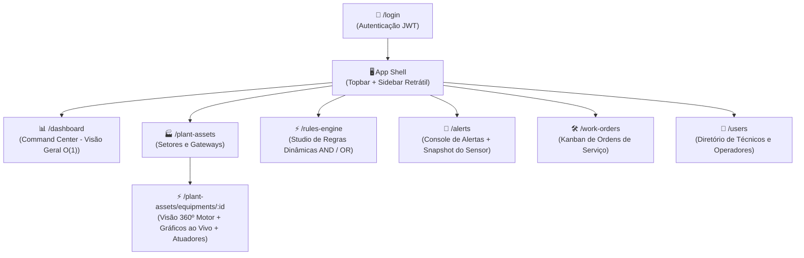

# 🏭 Industrial IIoT Frontend — SCADA/HMI Plant Monitor

Interface de monitoramento industrial e automação em tempo real para chão de fábrica, desenvolvida com **Angular 21**, **Signals**, **TypeScript (Strict Mode)** e **Tailwind CSS 4**. Integra-se a um backend **Spring Boot 3** e simuladores MQTT/Python para fornecer visualização de telemetria de alta frequência, detecção de anomalias com regras dinâmicas e gestão de ordens de manutenção.

---

## 📌 Visão Geral do Sistema

O sistema atua como uma aplicação **SCADA / HMI (Human-Machine Interface)** de baixa latência voltada para engenheiros, operadores e técnicos de manutenção.

```
                    ┌────────────────────────────────────────┐
                    │    Simulador IoT (Python / MQTT)       │
                    └───────────────────┬────────────────────┘
                                        │ Telemetria a cada 3s
                                        ▼
                    ┌────────────────────────────────────────┐
                    │     Backend: Spring Boot 3 API         │
                    │   (REST, SSE Streams, State Cache)     │
                    └───────────────────┬────────────────────┘
                                        │ /api/v1/** (Proxy)
                                        ▼
┌──────────────────────────────────────────────────────────────────────────────────┐
│                      Frontend: Angular 21 Standalone                             │
│                                                                                  │
│  [ Core: Http Interceptors, SSE Telemetry Stream, Domain Enums, Layout Shell ]   │
│  [ Shared: Health Badges, Sensor Gauges, Pipes de Formatação, Modais ]           │
│  [ Features: Dashboard O(1), Ativos, Rules Studio, Alertas, Kanban OS, Usuários]  │
└──────────────────────────────────────────────────────────────────────────────────┘
```

---

## 🗺️ Mapa Geral de Navegação (Sitemap)

A aplicação segue uma estrutura de **Single Page Application (SPA)** com navegação centralizada no **Shell** (Menu Lateral + Barra Superior):



---

## 🏗️ A Moldura Global: O App Shell (SCADA Dark Theme)

Todas as telas do sistema são renderizadas dentro da moldura fixa do Shell. Apenas a área central (`<router-outlet></router-outlet>`) é trocada ao navegar pelas rotas:

```
+-----------------------------------------------------------------------------------------+
| [IIoT Plant Monitor]   | 🟢 CONECTADO (SSE Ativo)   | 🚨 3 Alertas Pendentes | 👤 Igor H. |
+------------------------+----------------------------------------------------------------+
| ☰ MENU                |                                                                |
| 📊 Dashboard           |                                                                |
| 🏭 Ativos da Planta    |                                                                |
| ⚡ Motor de Regras     |                    CONTEÚDO PRINCIPAL                          |
| 🚨 Alertas (3)         |               (<router-outlet></router-outlet>)                |
| 🛠️ Ordens de Serviço  |                                                                |
| 👥 Usuários            |                                                                |
|                        |                                                                |
| ⚙️ Configurações       |                                                                |
+------------------------+----------------------------------------------------------------+
```

---

## 🗺️ Resumo de Telas & Endpoints Backend

> 📖 **Para ver os Wireframes ASCII detalhados de cada tela, consulte o documento completo:**  
> 👉 **[BLUEPRINT.md](BLUEPRINT.md)**

| Rota | Tela | Descrição & Funcionalidades | Endpoint Backend (`:8080`) |
| :--- | :--- | :--- | :--- |
| `/dashboard` | **Plant Health Dashboard** | Visão geral dos motores com leitura $O(1)$, cartões de status (`OPERATIONAL`, `WARNING`, `CRITICAL`), telemetria ao vivo e KPIs agregados. | `GET /api/v1/equipment-states` |
| `/plant-assets` | **Setores & Gateways** | Gestão da infraestrutura física da fábrica, cadastro de setores industriais e gateways de comunicação IoT com status online/offline. | `GET/POST /api/v1/sectors`<br>`GET/POST /api/v1/gateways` |
| `/plant-assets/equipments/:id` | **Visão 360º do Motor** | Detalhamento do motor com gráficos de série temporal em tempo real (últimos 50 pontos), mostradores analógicos (Gauges) e acionamento de atuadores. | `GET /api/v1/equipments/{id}`<br>`GET /api/v1/sensors`<br>`POST /api/v1/automation-rules/execute` |
| `/rules-engine` | **Rules Studio** | Construtor visual de condições lógicas (`SE ... E/OU ... ENTÃO`) para detecção de anomalias sem necessidade de recompilar código. | `GET/POST /api/v1/rule-groups`<br>`POST /api/v1/rule-groups/{id}/conditions` |
| `/alerts` | **Central de Incidentes** | Console de anomalias com gaveta de **Sensor Snapshot** (leitura dos sensores no segundo exato do disparo) e ações de reconhecimento. | `GET /api/v1/alerts`<br>`PUT /api/v1/alerts/{id}/acknowledge` |
| `/work-orders` | **Kanban de Manutenção** | Quadro visual do ciclo de vida das ordens de serviço (`OPEN` ➔ `IN_PROGRESS` ➔ `COMPLETED`) com atribuição de técnicos e laudos. | `GET/POST /api/v1/work-orders`<br>`PUT /api/v1/work-orders/{id}/status` |
| `/users` | **Diretório de Equipe** | Gestão de operadores, engenheiros e técnicos autorizados a operar a planta e assumir ordens de serviço. | `GET/POST /api/v1/users` |
| `/login` | **Autenticação Segura** | Autenticação via JWT, controle de sessão e guardas de rota (`CanActivateFn`). | `POST /api/v1/auth/login` |

---

## 🏛️ Padrões de Arquitetura

O projeto adota uma arquitetura limpa orientada a domínios (**Feature-Based Clean Architecture**):

```
src/app/
├── core/                  # Infraestrutura transversal e Singletons globais
│   ├── http/              # Interceptors funcionais (apiErrorInterceptor)
│   ├── layout/            # Layout Shell (Topbar, Sidebar retrátil)
│   ├── models/            # Enums do domínio e contratos de erro da API
│   └── realtime/          # Serviços de stream SSE e WebSocket
│
├── shared/                # Componentes "Burros" (Dumb/Presentational) reutilizáveis
│   ├── components/        # HealthBadgeComponent, SensorGaugeComponent, Modais
│   └── pipes/             # Formatadores de unidades e datas industriais
│
└── features/              # Módulos de domínio de negócio (Lazy-Loaded)
    ├── dashboard/         # Command center e cartões de saúde dos motores
    ├── plant-assets/      # Setores, Gateways, Equipamentos, Sensores e Atuadores
    ├── rules-engine/      # Studio de regras dinâmicas e automação closed-loop
    ├── alerts/            # Central de incidentes e inspeção de snapshots
    ├── work-orders/       # Kanban e fluxo de trabalho de manutenção
    └── users/             # Diretório de operadores e técnicos
```

### Regras de Engenharia
1. **Standalone Everything**: Sem módulos (`NgModule`). Todo componente, diretiva e pipe é `standalone: true`.
2. **Signals + RxJS Interop**:
   - **RxJS**: Utilizado exclusivamente para fluxos assíncronos de eventos (`HttpClient`, streams SSE `EventSource`, WebSockets, retry/backoff).
   - **Angular Signals**: Utilizado para estado de interface (`signal()`, `computed()`, `input()`, `output()`).
3. **Smart vs. Dumb Components**:
   - **Páginas (`pages/`)**: Injetam serviços, gerenciam estado e orquestram APIs.
   - **Componentes (`components/`)**: Recebem dados via `input()` e emitem eventos via `output()`, sem dependências externas.
4. **OnPush Change Detection**: Todos os componentes utilizam `ChangeDetectionStrategy.OnPush` para garantir atualização suave a 60 FPS com telemetria contínua a cada 3 segundos.
5. **Novo Control Flow**: Utilização exclusiva de `@if`, `@for` e `@switch` nativos do Angular.

---

## 🚀 Como Executar o Projeto

### Pré-requisitos
- **Node.js**: v20+ ou v22+
- **NPM**: v10+
- **Backend Spring Boot**: Rodando na porta `8080` (ou via Docker)

### Instalação e Execução
```bash
# 1. Instalar dependências
npm install

# 2. Iniciar o servidor de desenvolvimento com proxy para o backend (:8080)
npm start

# 3. Executar o build de produção
npm run build

# 4. Executar os testes unitários (Vitest)
npm test
```

A aplicação estará disponível em `http://localhost:4200/`. Todas as chamadas para `/api/v1/**` são automaticamente encaminhadas via `proxy.conf.json` para `http://localhost:8080`.

---

## 📄 Licença

Este projeto é desenvolvido para fins educacionais e de demonstração de arquitetura industrial IIoT moderna.
